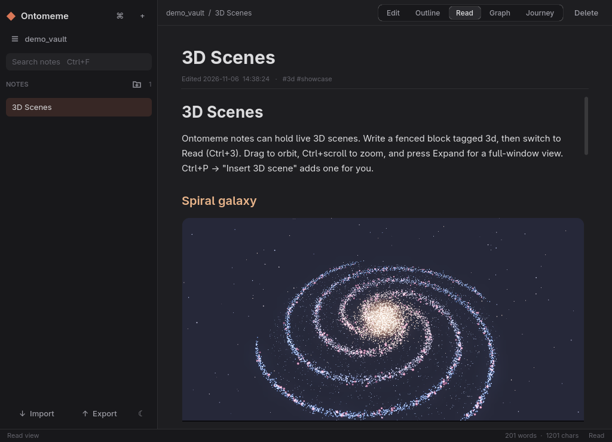

# Ontomeme

The multimedia note-taking app for humans and their agents. Notes are stored as text files, and Godot-native text resource files. Designed to optimize AI via MCP toward autodidactic pursuits, self-directed educational goals, and knowledge sharing.
Write plain Markdown, and ```` ```3d ```` blocks which turn into live 3D scenes right inside your notes. Display 3d models and orbit around them. Create a quiz whose answers float in space.

- **Markdown notes in real folders** — your vault is a directory on disk. Open
  it in any editor, back it up, version it.
- **Live 3D scenes** — procedural presets, or drop in your own `.glb` / `.gltf`
  models.
- **3D quizzes and flashcards** — answer by clicking objects in the scene;
  progress marks show what you've passed and what needs review.
- **Learning Journey** — a tab that strings lessons into a path and tracks how
  far along it you are.
- **`[[links]]` between notes**, with missing targets created on click.
- **Built-in tutorials** that teach the app from inside the app.

Built with [Godot 4](https://godotengine.org): a native desktop app, no browser,
no account, no cloud. Your notes stay on your machine.

## Demo



[Watch the demo video](media/demo.mp4): three of the built-in 3D scenes,
turning inside a note.

## Install

Download Ontomeme from the [Releases](../../releases) page. Pick the file for
your computer:

| Computer | File to download |
|---|---|
| Windows | `Ontomeme-<version>-windows-x86_64.zip` |
| Mac (Apple Silicon or Intel) | `Ontomeme-<version>-macos.dmg` |
| Linux | `Ontomeme-<version>-linux-x86_64.AppImage` |

Ontomeme is free and not yet "signed" with a paid certificate from Apple or
Microsoft. That means your computer will warn you the first time you open it.
This is expected. The steps below show you how to open it anyway. You only
need to do this once.

Your notes are kept in a folder called **Ontomeme** inside your **Documents**
folder.

### Windows

1. Open your **Downloads** folder and find the `.zip` file you downloaded.
2. Right-click it and choose **Extract All…**, then click **Extract**.
3. Open the new folder and double-click **Ontomeme**.
4. A blue box may appear saying *"Windows protected your PC"*. Click
   **More info**, then click **Run anyway**.

Tip: to find Ontomeme easily next time, right-click **Ontomeme** and choose
**Pin to Start**, or move the folder somewhere you like, such as your
Documents folder.

### Mac

1. Open your **Downloads** folder and double-click the `.dmg` file. A window
   with an app called **Ontomeme** opens.
2. Drag **Ontomeme** onto the **Applications** shortcut in that window, then
   close the window.
3. Open **Applications** and double-click **Ontomeme**. Your Mac says
   *"Apple could not verify…"* or *"Ontomeme can't be opened"*. Click
   **Done** (or **OK**) to close the message.
4. Click the **Apple menu** (the apple in the top-left corner of the screen) → **System Settings** → **Privacy & Security**.
5. Scroll down to the **Security** section. Next to the line about
   Ontomeme, click **Open Anyway**.
6. Enter your Mac password if asked, then click **Open Anyway** once more.

On macOS 14 (Sonoma) and earlier there is a shortcut for steps 3 to 6:
**right-click** (or hold **Control** and click) **Ontomeme**, choose
**Open**, then click **Open** again in the box that appears. From macOS 15
(Sequoia) on, that box has no **Open** button, so use the steps above.

When Ontomeme opens for the first time, your Mac asks if it may access files
in your **Documents** folder. Click **Allow** (or **OK**): that is where your
notes are kept. If you click **Don't Allow**, Ontomeme keeps your notes in a
folder called **vault** in its app data folder instead
(`~/Library/Application Support/Godot/app_userdata/Ontomeme`), and the bar
at the bottom of its window says so. Each time it opens, it tries
**Documents** again: once you allow access, it makes a new **Ontomeme**
folder there with only the starter notes, and the notes you wrote stay
behind in **vault**. To move your notes into **Documents**, follow these
steps in order, without opening Ontomeme in between:

1. Open **System Settings** → **Privacy & Security** → **Files & Folders**
   and turn on **Documents Folder** under **Ontomeme**.
2. Quit Ontomeme.
3. In **Finder**, choose **Go** → **Go to Folder…**, paste
   `~/Library/Application Support/Godot/app_userdata/Ontomeme` and press
   **Return**.
4. Rename the folder **vault** to **Ontomeme**, then drag it onto
   **Documents** in the Finder sidebar. If **Documents** already has an
   **Ontomeme** folder, don't replace it: see below.
5. Open Ontomeme. It opens your notes from the **Ontomeme** folder in
   **Documents**.

If Ontomeme already made a new **Ontomeme** folder in **Documents**, your
notes are still in **vault**: click the folder name at the top of
Ontomeme's sidebar and choose **vault** to open them.

Your **Ontomeme** folder may already be in **Documents** when your Mac
refuses access: you turned off **Documents Folder** (see step 1), or your
Mac asked again after an update and you clicked **Don't Allow**. The
notes you write until access is back go into **vault**, and once you allow
it, Ontomeme opens your **Ontomeme** folder without them. The bar at the
bottom of its window then says how many are still in **vault**. Don't drag
**vault** onto your **Ontomeme** folder, which would replace it. Instead,
allow access (step 1), open Ontomeme, click **↓ Import** at the bottom of
its sidebar, and click **Import** in the window that opens on **vault**.
That brings in the notes written in **vault**, without the ones your
**Ontomeme** folder already has.

After the first time, Ontomeme opens with a normal double-click.

If your Mac says *"Ontomeme is damaged and can't be opened"*, click
**Cancel**, not **Move to Trash**. Your Mac says this about some apps from the
internet that aren't signed. (To be sure the download arrived whole and
unchanged, [check it](#check-your-download-optional) first.) Open
**Terminal** (in **Applications** → **Utilities**), paste this line and
press **Return**, then open Ontomeme again:

```
xattr -dr com.apple.quarantine /Applications/Ontomeme.app
```

### Linux

Ontomeme ships as a single self-contained file, an
[AppImage](https://appimage.org/): there is nothing to extract or install.

1. Move the download to a folder you keep, for example **Applications** or
   **Software** in your home folder, so you find it easily next time.
2. Give it permission to run (the download usually does not have it):
   right-click the `.AppImage` file, choose **Properties** and turn on
   **Allow executing file as program** (on some systems it is called
   **Executable as Program** or **Is executable**, sometimes on a
   **Permissions** tab). Or in a terminal, in that folder:
   ```
   chmod +x Ontomeme-*-linux-x86_64.AppImage
   ```
3. Double-click the `.AppImage` file. Some file managers open it as a file
   or do nothing instead of running it; then run it from a terminal in its
   folder:
   ```
   ./Ontomeme-*-linux-x86_64.AppImage
   ```

If it does not start, run it this way instead (some systems lack the
**FUSE** library an AppImage starts with):

```
./Ontomeme-*-linux-x86_64.AppImage --appimage-extract-and-run
```

### Check your download (optional)

Each release also has a file called `SHA256SUMS.txt`, with a fingerprint (a
SHA-256 checksum) of every download. If yours matches, your file arrived
whole and is the one the release built. Download `SHA256SUMS.txt` into the
same folder as your download, open a terminal there (for example with
`cd ~/Downloads`) and run the line for your computer:

- Linux: `sha256sum -c SHA256SUMS.txt --ignore-missing`. It prints `OK`
  after the name of your file.
- Mac: `shasum -a 256 Ontomeme-*-macos.dmg`. Compare the long number it
  prints with the one on that file's line in `SHA256SUMS.txt`.
- Windows, in PowerShell (right-click in the folder and choose **Open in
  Terminal**): `Get-FileHash Ontomeme-*-windows-x86_64.zip`. Compare the
  **Hash** it prints with the one on that file's line in `SHA256SUMS.txt`;
  capital letters don't matter.

## Updating

Download the new version from the [Releases](../../releases) page and
install it the same way, in place of the old one:

- **Windows:** quit Ontomeme, extract the new `.zip` and open **Ontomeme**
  in the new folder. You can then delete the old folder.
- **Mac:** quit Ontomeme, open the new `.dmg`, drag **Ontomeme** onto the
  **Applications** shortcut and click **Replace**. Your Mac may ask you to
  click **Open Anyway** again.
- **Linux:** quit Ontomeme, give the new `.AppImage` permission to run
  ([step 2](#linux)) and open it. You can then delete the old `.AppImage`.
  If Claude starts Ontomeme ([below](#use-with-claude-desktop-mcp)), change
  the path in its entry to the new file.
  If your old version came as a folder (a `.tar.gz` download), delete that
  folder too, unless it has an **Ontomeme** folder inside: on some Linux
  setups an earlier version kept your notes there, and the new one tells
  you so when it starts. Quit Ontomeme, move that folder somewhere safe,
  such as **Documents**, and open it there with **Open folder as vault…**
  (the vault menu) before you delete the old one.

Your notes stay where they are, and the new version opens them: that is
the **Ontomeme** folder inside **Documents**, unless you opened another
folder or clicked **Don't Allow** on a Mac. There is nothing to copy.

## Use with Claude Desktop (MCP)

Ontomeme can let Claude work with your notes. Claude Desktop starts Ontomeme
in the background as an [MCP](https://modelcontextprotocol.io) server (no
window opens), and Claude can then list, search, read, create, edit and
delete the notes in your vault. Ontomeme can stay open while it does: the app
shows Claude's changes within a couple of seconds.

1. Install Ontomeme (see above) and open it once, so it has a notes folder.
   On a Mac this also gets past the security warning, which would otherwise
   stop Claude Desktop from starting it.
2. In Claude Desktop, open **Settings → Developer → Edit Config**. This opens
   the file `claude_desktop_config.json`, which lives in:
   - Mac: `~/Library/Application Support/Claude/`
   - Windows: `%APPDATA%\Claude\`
3. Add the `"ontomeme"` entry below under `"mcpServers"`. If the file already
   lists other servers, add it next to them. Change the path to where
   Ontomeme is on your computer. Or let Ontomeme fill it in: press Ctrl+P
   (Cmd+P on a Mac), choose **Connect Claude Desktop…** and click **Copy**.
   That entry has your Ontomeme's path and the vault you have open.

Mac, with Ontomeme in your Applications folder:

```json
{
  "mcpServers": {
    "ontomeme": {
      "command": "/Applications/Ontomeme.app/Contents/MacOS/Ontomeme",
      "args": ["--headless", "--log-file", "user://logs/mcp.log", "--", "--mcp-stdio"]
    }
  }
}
```

Windows, pointing at `Ontomeme.exe` in the folder you extracted (in this
file every `\` is written twice):

```json
{
  "mcpServers": {
    "ontomeme": {
      "command": "C:\\Users\\YOU\\Downloads\\Ontomeme-windows-x86_64\\Ontomeme.exe",
      "args": ["--headless", "--log-file", "user://logs/mcp.log", "--", "--mcp-stdio"]
    }
  }
}
```

Linux, pointing at the `.AppImage` file itself, here in an **Applications**
folder in your home folder (Claude Desktop is made for Mac and Windows; other
MCP clients that read this format take the same entry):

```json
{
  "mcpServers": {
    "ontomeme": {
      "command": "/home/YOU/Applications/Ontomeme-<version>-linux-x86_64.AppImage",
      "args": ["--headless", "--log-file", "user://logs/mcp.log", "--", "--mcp-stdio"]
    }
  }
}
```

`"--log-file", "user://logs/mcp.log"` gives the server a log of its own,
`mcp.log`, next to `godot.log`. That log holds what Claude read from your
notes; without these two args it would land in `godot.log`, the log a bug
report asks you to attach.

4. Quit Claude Desktop completely and start it again. Ontomeme's tools appear
   in the tools menu of a new chat.

Claude works in the vault the app last opened, except the **vault** folder
a Mac keeps your notes in after **Don't Allow** (see [Mac](#mac)): Claude
keeps looking for the **Ontomeme** folder in **Documents**, as Ontomeme does
each time it opens, and finds no vault while there is none. Once you choose
**vault** at the top of Ontomeme's sidebar, it is the vault the app last
opened, and Claude works there too. To use another vault, add
`"--vault=/path/to/vault"` after `"--mcp-stdio"` in `"args"` (on Windows,
for example `"--vault=C:\\Users\\YOU\\Documents\\Ontomeme"`).

Claude asks you before it edits or deletes a note. Deleted notes go to the
`.trash` folder inside your vault and are never erased: move a file back out
of `.trash` to restore it. (Folders whose names start with a dot are hidden;
on a Mac, press Cmd+Shift+. in Finder to show them.)

If the tools don't appear, **Settings → Developer** shows whether the server
started, and its log is `mcp-server-ontomeme.log` in `~/Library/Logs/Claude/`
(Mac) or `%APPDATA%\Claude\logs\` (Windows). The tools and the server's
details are in [mcp/README.md](mcp/README.md).

### What Claude can do

- **Only the vault you chose.** Claude can list, read, create, edit and
  delete notes inside that one folder. A path that climbs out of it (`../`),
  an absolute path and a path into one of its hidden folders are refused.
  Symbolic links that lead outside the vault are refused too, so a link to
  a folder elsewhere doesn't let Claude reach it.
- **Edits and deletes need your approval.** Ontomeme tells your MCP client
  that they change your notes, so the client asks you before it runs one.
- **Deletes go to `.trash`.** Nothing is erased; you can move a note back.
- **Notes can't bring code.** A note file with embedded code (a script
  inside it, or one it points to) is refused, never loaded, so nothing in
  a note runs. The server has no shell and no network access: it can't run
  programs or open connections.
- **No changes based on an old read.** If a note changed after Claude read
  it (you typed in it, a sync tool replaced it), Claude's edit or delete is
  refused and it has to read the note again, so your words are never
  overwritten.

If your MCP client can show Ontomeme's own confirmation prompts, Ontomeme
also asks before each edit or delete; to turn that off, add
`"--confirm-writes=off"` after `"--mcp-stdio"` in `"args"`.

Claude follows what it reads, and a note can contain text written to steer
an AI. Read what Claude asks to change before you approve it, especially in
notes you didn't write.

## Reporting a problem

Something not working? [Open a bug report](../../issues/new/choose). You
don't need to know any code. The form asks for two things that help most:

- **Diagnostics:** in Ontomeme, press **Ctrl+P** (**Cmd+P** on a Mac),
  choose **About Ontomeme** and click **Copy diagnostics**, then paste it
  into the report. It is one line with your Ontomeme version, your system,
  and where your notes and the log are.
- **The log file**, `godot.log`: press **Ctrl+P** (**Cmd+P** on a Mac),
  choose **Open log folder** and drag `godot.log` into the report. If
  Ontomeme doesn't open at all, look for it here, and if the folder isn't
  there, say so in the report:
  - Windows: `%APPDATA%\Godot\app_userdata\Ontomeme\logs\godot.log`
  - Mac: `~/Library/Application Support/Godot/app_userdata/Ontomeme/logs/godot.log`
  - Linux: `~/.local/share/godot/app_userdata/Ontomeme/logs/godot.log`

The log is plain text, so you can read it before you send it.

## Run from source

1. Install [Godot 4.7](https://godotengine.org/download).
2. Clone this repository and open `project.godot` in Godot, or run
   `godot --path .` from the repository root.

## Tests

```
GODOT=godot tests/run_all.sh                             # every test
godot --headless --path . -s res://tests/<name>_test.gd  # one test
```

Each test prints `RESULT: ALL PASS` on success, and `run_all.sh` ends with
`ALL TESTS PASS`. See
[`skills/ontomeme-notes/SKILL.md`](skills/ontomeme-notes/SKILL.md) for the
tools used to write and check lesson notes.

## Contributing

Bug reports and pull requests are welcome. [CONTRIBUTING.md](CONTRIBUTING.md)
shows how to set up Godot, run the tests without touching your own notes,
and send a change.

## License

MIT — see [LICENSE](LICENSE).
